# ASMR Platformer (Roblox)

A 3D platformer where every platform is a different tactile material. Each one reacts
to the player in its own way: honey dents and slowly recovers, soap crumbles under your
feet, wax cracks and lets you sink into the butter underneath, bubble wrap pops, lava
bubbles and spits before it bursts.

Under the platforming there is a story. Every level is Harrow Bay on 14 August, the day the
sea came in, a little later each time, and the pumping station's key holder never came to work.
The people there live it as an ordinary day. At the end the time card on the wall has your name
on it.

**Status:** in development, not yet published. 27 materials across 67 chunk templates, 4 levels
and a Sandbox chosen from a lobby, 11 people with lines, 27 keepsakes, 5 secrets, an ending
for every level shot as a scene with its own sounds, and a shop: tokens earned by finishing levels,
cosmetics, passes and token packs. Every material has a sound (generated
stand-ins where there is no recording yet). See [Status](#status) for what has been tested, what
is waiting for a test, and what is not built yet.

## Screenshots

| | |
|---|---|
| 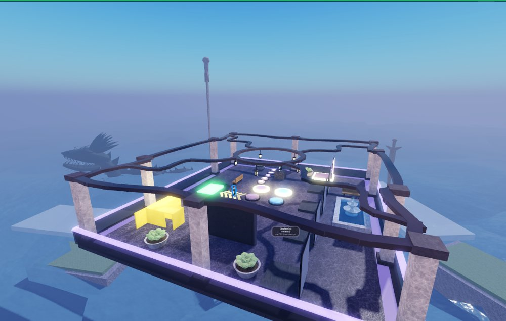 | 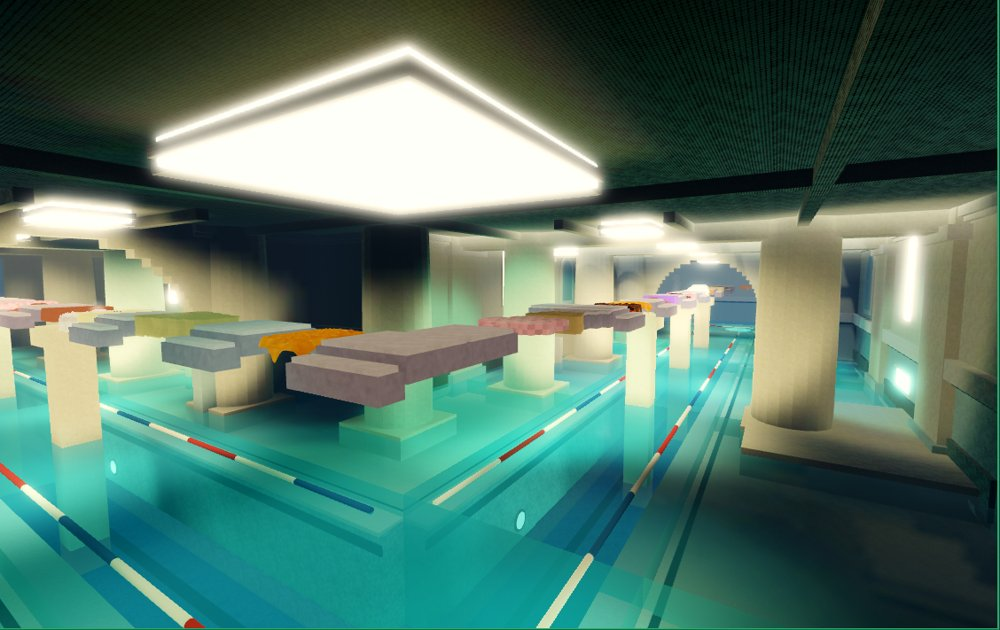 |
| **The lobby**, where players vote on level, mode and run length | **The Flooded Halls**, a bathhouse level built along the platform route |
| 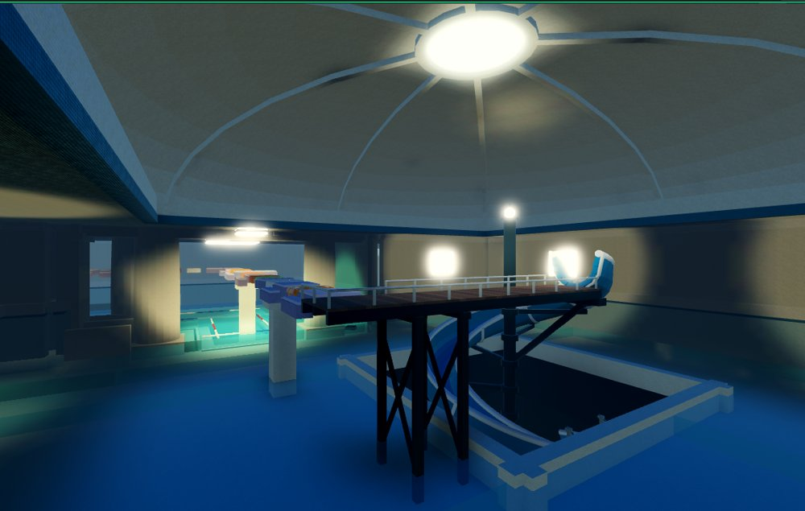 | 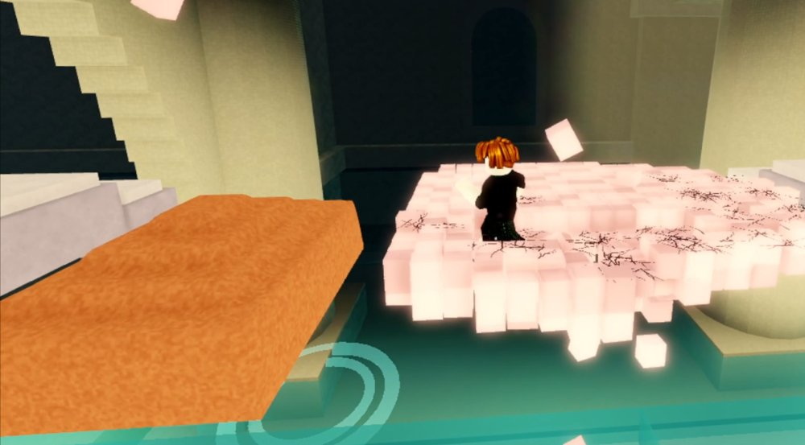 |
| **The final chamber**, where the run ends on a water slide | **Soap** breaking into cubes under the player |
| 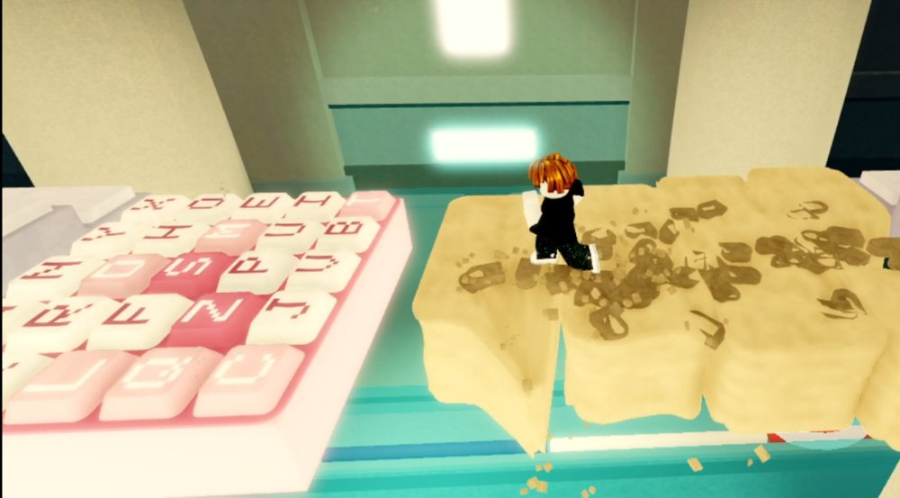 | 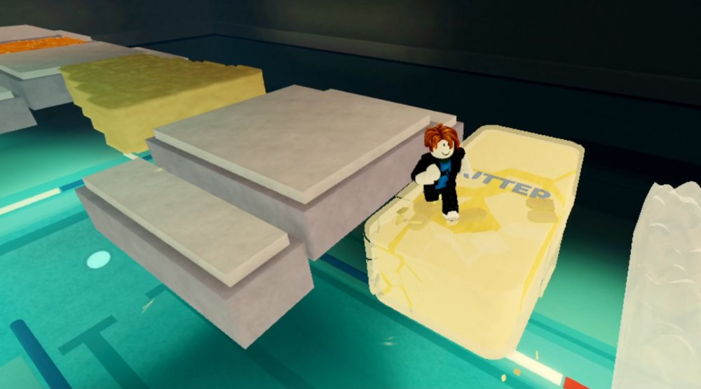 |
| **Kinetic sand** holding footprints and shedding clumps | **Butter-wax** coating cracking into shards |

### Materials in motion

| Soap | Butter-wax | Kinetic sand |
|---|---|---|
| 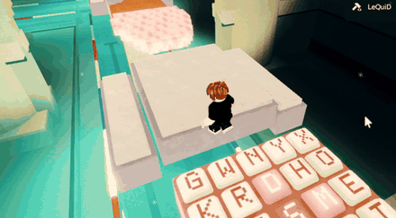 | 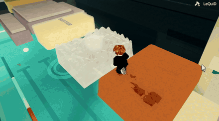 | 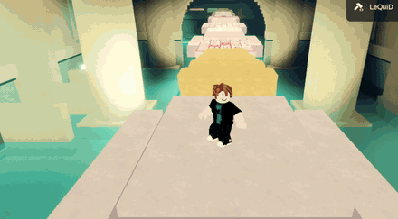 |
| Cubes break off and fall as debris, opening a hole you drop through | The wax coating cracks into shards and the butter keeps the dent | Footprints stay, and the surface sheds clumps from the rim |

| Jello | Lego | Lava |
|---|---|---|
| 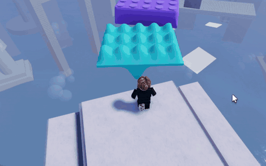 | 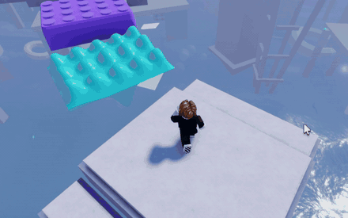 | 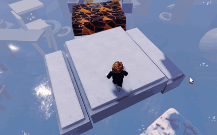 |
| Wobbles and ripples outward from each step | Studs press down under your feet | Crust cracks open to glowing lava beneath (the screenshot is from before the embers and bubbles) |

| Honey | Memory foam |
|---|---|
| 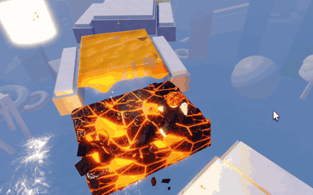 | 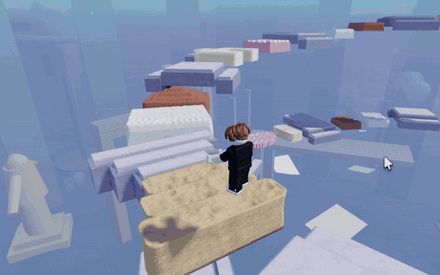 |
| Footprints sink in and slowly flow closed | Presses in and holds the dent |

## The game as it stands

### The lobby

A promenade on piers over the sea, built once and kept while runs are built and torn down. You arrive on the plaza,
by the fountain under the canopy, and four boardwalks lead off it:

- **The level gates (north):** a pad for each level in an arc round the Start, each with a window in its own sky
  (boarded up until the level before it is finished), the Story pad and the Sandbox; on the way in, the Chill and
  Hardcore keys and the Short, Medium and Long keys. Players vote and the server builds the run from their choices.
- **The hall of fame (east):** the leaderboard facing the way in, and your statue with its pose keys.
- **The arcade (west):** the shop's kiosk, the daily chest, the challenges and materials boards, the codes post box,
  and a small closed house with a yellow light in its doorway.
- **The garden (south):** a lawn, benches facing the sea, the lift to the squish room, and a coin-op telescope that
  is the only way into first person: "Look through" and you are in first person from then on, "Step back" and you
  are back in a proper third person view.

### The levels

They are numbered in the order they happen on 14 August.

| # | Level | When | The route | The ending |
|---|---|---|---|---|
| 1 | City Shore | 9:14 in the morning | a spiral climbing over a pastel beach city round a bay, the Siren Tower in the middle | a high dive off a springboard into the sea: a cut back to Maren watching, a flock of gulls you fall through, and under the water a drowned street with one lamp still on |
| 2 | Sky Pools | three in the afternoon | a meander going down past pool terraces over a drifting cloud sea, round a fountain tower | a sled down the slide, through the clouds, skipping across the final pool |
| 3 | The Sunken City | eight minutes to midnight | a ring just above a drowned city, with something enormous under it, an aquarium and a dry flat off the checkpoints | a whirlpool at the end of the pier pulls you down the harbour drain and along Outfall 3 to the pumping station, where the time card has your name |
| 4 | Flooded Halls | four minutes to midnight | the Corporation Baths, their tiled corridors built along the platform route | a flume into the dark, a mouth at the bottom of the fall, then the Gate Chamber, where you open Outfall 3 with the key that was in your pocket all along |

Every level has its own light, its own ambience bed, its own completion banner drawn in its own
motif, and six seconds to look round after LEVEL COMPLETE before the lobby.

### The story

- **People** (Sal, Pip and Maren at City Shore; Dev, Mrs Okafor and Rudy at the Sky Pools; the
  attendant and the fisherman in the Sunken City; Mrs Venn, Tobi Okafor and Mr Barlow in the baths)
  greet you, follow you with their eyes, have habits of their own and talk when you press F.
- **The journal** (J): the letters, notes and keepsakes you pick up, to read when you choose.
  Nothing comes up over the level.
- **Keepsakes**: every material is something someone in Harrow Bay was holding when the water came
  (27 of them), picked up as toys from lit nooks off the route.
- **Secrets**: five across the levels, opened with Mr Barlow's pry bar or a sharp eye, each found as
  a short scene (City Shore's is the Siren Tower in the middle of the spiral).
- `LORE.md` is the canon; `story/HARROW_BAY.fountain` is the story as a screenplay.

### The endings

Each ending is a scene with its own camera, letterbox bars and captions held until you have read
them; the level's own sound falls silent and the scene is scored with sounds of its own (the board
letting you go, the wind all the way down, the splash, the hum under the harbour, a last chord).
The banner and the lobby wait for the scene to finish.

### The squish room

A pink lift in the lobby's garden takes you to a quiet hall with a real slab of every material
in the game, each named, set into the floor: walk on them, squeeze the Needoh, pop the bubble wrap, sink
into the honey, for as long as you like. The lift inside takes you back.

### Your first visit

A short welcome (three pages, with the controls for the device you are on), then a guide in the lobby
that points at City Shore, Chill, Short and Start in turn. In a level, the first time you stand on each
material one line at the bottom says what it does, once. After your first finished run a marker shows
the way to the shop.

### The shop

A striped kiosk in the lobby's arcade (and a Shop button in the pause menu) opens a bright, chunky shop
whose buttons press down and spring back like the materials. Finishing a level earns tokens (more for
longer runs, Hardcore and a new best); tokens buy trails, auras, footprints, step sounds and emotes. Robux buys token packs, a 2x tokens pass, VIP and a hardcore second chance (which never counts for
the leaderboard). Saves are session-locked
(ProfileStore), so nothing can be duplicated, and every purchase is granted exactly once.

### Controls

| Key | What it does |
|---|---|
| WASD, Space | move and jump; standing still on the Needoh charges a bigger jump |
| Ctrl | lock the cursor in the middle (the camera turns with the mouse, you face where you look), and free it again |
| E | the prompts: take, look, tap, slide, ride, sit, and the shop at the kiosk |
| F | talk to someone |
| G (D-pad right on a controller) | the emotes |
| J (D-pad up on a controller) | the journal |
| Esc or M (D-pad down on a controller) | the pause menu (and the shop from it) |
| F7 | hide or show the Sunken City's Studio panel (in Studio only) |

## The materials

The six original materials, and how each one works:

| Material | How it works |
|---|---|
| Honey | Rigged mesh with one bone per cell; footsteps push dents that recover over time |
| Slime | Rigged mesh with springy bone waves that snap back, and a launch with a camera kick |
| Soap | Built from small cubes that break off one by one as physics debris, dropping you through |
| Butter-wax | Butter block under a wax coating split into Voronoi shards; shards push apart where you stand |
| Kinetic sand | Rig presses a bowl, a stamped sole sits inside it; cells collapse after 3 footsteps |
| Bubble wrap | One bone per pocket; pockets under your foot pop flat, heard the moment you step |

Later materials go beyond denting under your feet. Each one changes how you have to move:

| Material | Mechanic |
|---|---|
| Clay | Each step squeezes clay into the cells around it; an edge lip that takes too much tears off and falls with whoever is on it |
| Salt | Packing a cell pushes brine sideways, cracking, tilting and finally sinking the crust around you |
| Arcade keypads | Three switch types: clicky (cyan) buttons give a speed surge, linear (violet) buttons store charge that the next clicky press releases as a bigger surge, and tactile (pink) buttons raise your jump, higher with each bounce from pink to pink |
| Needoh | Standing still squeezes the bed and charges a jump up to 2.2x normal height; it has its own gloopy squish, not clay's |
| Charcoal | Stepping lights a coal; fire spreads to neighbours and burnt coal turns to ash and gives way |
| Oobleck | Players slowly wade in unless they keep moving; a hard landing hardens the whole pool for everyone |
| Lava | A crust over glowing lava that breathes light, throws off embers and heat haze, and bubbles and spits; it spurts where you stand and erupts in a fountain when a cell bursts |
| Jellyfish | A glowing bell you bounce across (the Sunken City's own chunks) |

The rest: ice, jello soda, lamb's ear, foam, light switches, lego, chocolate (soft
and solid), cloud, snow, a creamy keyboard, lava keys and a butter stick. Cracks on soap and
charcoal grow outward from the footstep that caused them, every collapse drops the player at once,
and every hole fills itself back in within 30 seconds.

## Status

Last updated: 2026-10-18. **Everything up to and including the ninety-second pass has been played in Studio (you).**
Twelve passes since (93 to 104) wait for a test (below). `ROADMAP.md` has the detail on everything not built yet and the order it
comes in, and `HANDOFF.md` on everything built, pass by pass.

### Tested in Studio and working (through the ninety-second pass)

- **The four levels and their endings, each a scored scene with its own banner:** City Shore's high dive into the bay,
  the Sky Pools' slide round the fountain tower into the last pool, the Sunken City's drain down Outfall 3 to the
  pumping station, and the Flooded Halls' flume into the mouth in the dark and on to the Gate Chamber.
- **Story mode:** the four levels in order on one Hardcore clock with its own leaderboard, your place kept in your
  save, a fade between levels that holds everyone, and a reward and a ribbon at the end.
- **The lobby:** the level pads and the vote, levels opening in order, the VIP tag, the daily chest, the daily
  challenges board, the codes post box, the statues and leaderboards, the seaside viewer, the lift to the squish
  room and the back corridor.
- **The secrets:** the back rooms of the baths (the seventh fall in a run), a hidden token cache on every level, and
  on every level the letters, the keepsakes and the pry bar's secret, kept in the journal between sessions.
- **The shop and the economy:** tokens, trails, auras, footprints, step sounds, emotes and the second chance, the
  starter pack, game passes and token packs, a friend's bonus, the materials collection, and badges (switched off
  until their ids are in).
- **Your first visit and every device:** the welcome, the lobby guide, one hint per material, and the menus on a
  controller and a phone.
- **Sound:** every material's takes (the eleven chunk sounds remade twice from your notes), the townsfolk's mumbled
  voices, every level's ambience and every ending's score.
- **The Studio tools:** the paste check (anything missing, misplaced, an old copy, another module's code, a
  ProfileStore that is not loleris's), the test panel (F8) and its Self-test.

### Built, waiting for a test in Studio

- **Ninety-third pass (2026-10-17), the camera checked shot by shot:** every scripted shot in levels 1 to 4 (44 of
  them) is played through the game's own camera frame by frame by a new checker (`blender/check_shots.py`), and what
  it found is fixed: the flume's end, the mouth's shots (longer, you in the picture) and the key and the wheel in the
  Gate Chamber; City Shore's leap, drop, water and under-the-water shots; the Sky Pools' landing; the Sunken City's
  drain bottom and the culvert to the light.
- **Ninety-fourth pass (2026-10-17), the butter sticks:** one shallow dent where you step, no wave of dips running
  across the chunk after it, and the wax wrapper going down and back up with the butter instead of sitting over the
  dents as a flat lid.
- **Ninety-fifth pass (2026-10-18), from your fourth test:** the fall into the mouth dark but not black (you lit
  from above all the way down, the halls round you still unseen, the mouth with a faint cold glow of its own); and the
  Sunken City's drain under the water once you are through the funnel, so the whirlpool overhead is in the sea, not
  hanging in the sky.
- **Ninety-sixth pass (2026-10-18), the sounds:** every generated sound remade from sound models of the real thing
  (water as bubbles, chords as a felt piano and strings, real rooms), each at its old loudness: the story's, the
  endings', the levels' beds and the keypad (arcade buttons, not zaps), leaving the ones you liked as they were; the
  journal's own
  pencil-on-paper sound; and the lobby's own soundscape, never the same twice (seven files, sheets of takes played at
  random). A sixteenth checker (`check_audio.py`) holds every sound file to the house rules.
- **Ninety-seventh pass (2026-10-18), the shop:** seventeen Blender-modelled pieces, and every trail, aura and set of
  steps made of them and animated on every screen: sprinkles tumbling, honey dripping and spreading, bubbles popping,
  stars circling, snowflakes falling, fireflies with beating wings, steps pressed into the ground.
- **Ninety-eighth pass (2026-10-18), the levels' water:** every splash, drip, lap and pour in the levels its own
  (six files of splashes, dips, drips, lapping, pouring and a stream), a different take each time, where all of it
  was the engine's one splash.
- **Ninety-ninth pass (2026-10-18), one style:** one palette, one set of corners and outlines, all from one module
  (`Style.lua`). A seventeenth checker (`check_style.py`) keeps it that way.
- **Hundredth pass (2026-10-18), the lobby as a promenade:** five decks on piers over the sea, joined by boardwalks:
  the plaza, the level gates (the pads in an arc round the Start), the hall of fame, the arcade and the garden; rails
  with stone copings, lamp posts with real lights, the level pads' windows glass lit from behind, a lawn in the
  garden. Every place comes from one table (`LobbyLayout.lua`), drawn from above by `blender/plan_lobby.py` and
  measured by `check_hub.py`. The back corridor stands in a small house in the arcade now, and its turn can be
  walked (two of its walls ran across it, so its far end could never be reached).
- **Hundred-and-first pass (2026-10-20), sounds where they are:** the fountain heard near it and fading as you walk
  away; every level pad, key, pose key and the Start making its own sound when anyone steps on it, heard from the pad;
  the leaderboard's lever cranked down to Hardcore with a ratchet and a heavy clunk, flicked back to Chill with a soft
  click; Sky Pools' long falls breaking into spray instead of standing as white lines to the clouds; the bubble wrap's
  pops seen; and your own soap recording played alone.
- **Hundred-and-second pass (2026-10-20), one family and every device:** every word in the game in Nunito, told apart
  by weight and slant alone; the fixed panels fitted to any screen; and the Self-test measuring every screen on the
  device it runs on (things off an edge, words that do not fit, buttons under a thumb).
- **Hundred-and-third pass (2026-10-20), the back rooms:** the way back through the door you came in by (from the lobby
  only); the rooms carpeted and plastered, with a ceiling grid, skirting and damp; him stooped and bowed under the
  ceiling, seen only in jerks, the lights dying round him and your heart quickening; and the screamer: the lights out,
  then his blank face splitting open into the Hold's mouth an arm's length from you.
- **Hundred-and-fourth pass (2026-10-20), what you say to them:** talk to anyone and choose what to say (walk away and
  the choices go); and the story underneath it, which you chose: you are Edwin Marsh's child, learned a piece at a
  time from what people answer, each piece in your journal.
- `HANDOFF.md` has the checklists for passes 93 to 104.

### Pass by pass, newest first

- **Ninety-second pass (2026-10-17), from your third test:** the Flooded Halls' dark no longer hides the mouth (it
  was fog; now the shaft's lamps go down instead), you turn over to face it and a close look at your face as you see
  it; City Shore's dive looks down at the sea, with thoughts and a close look at your face on the way; and the paste
  check names a module with another module's code in it (BackRoomsService's in BackdropService took City Shore's
  land and sea away), any spelling of a script's name, and a ProfileStore that is not loleris's.
- **Eighty-sixth to ninety-first passes (2026-10-16), from your second test:** hollow lockers whose doors swing out,
  with a lamp and what is kept in them, and their scenes shot from the side; the fall into the mouth in the dark,
  with a lunge and new shots; eleven chunk sounds remade as one upload each (the chocolate cracks, the bubble wrap
  keeps up); mumbled voices for the townsfolk; things sunk into the back rooms, E. Marsh walking them, and the way
  back to the lobby; a new VIP tag, embers and countdown; the keepsakes' count fixed; one typeface for the story.
- **Seventy-eighth to eighty-fifth passes (2026-10-16), from your first test:** the salt, clay, cloud, lamb's ear,
  snow and charcoal sounds remade; shop step sounds only off the levels, soft and now and then; the shop's words, an
  "i" on every tile, fancier trails and auras and nine new things to buy; City Shore's dive hit with impact frames
  and wind; the pry bar seen at work with you acting in the scene; Sky Pools' slide showing where it is going; the
  Sunken City's whirlpool as smooth meshes; the Flooded Halls' flume ridden lying back and panicking, without the
  judder, with water in it and a mouth that springs open in the dark; and the townsfolk telling their lines with
  their bodies.
- **Seventy-seventh pass:** codes you post, typed into a post box in the lobby for tokens, from one list in
  `ShopCatalog.lua`.
- **Seventy-sixth pass:** a review of passes 18 to 49: best times written in one step so none is lost, and an
  emote's stop no longer floods.
- **Seventy-fifth pass:** a review of passes 50 to 74, and two fixes on the player's own screen.
- **Seventy-fourth pass:** the 27 materials as a collection: found by standing on each in a level, kept in the
  journal and on a lobby board, all of them for a trail and a badge.
- **Seventy-third pass:** a starter pack: a 99 Robux pass with 500 tokens and a trail sold nowhere else, first in
  the shop's Featured tab.
- **Seventy-second pass:** daily challenges: three a day for tokens, on a notice board in the lobby that shows each
  player their own.
- **Seventy-first pass:** a run finished with a Roblox friend in it pays a fifth more, told on the card, the pill
  and the invite.
- **Seventieth pass:** a hidden token cache on every level, found once a save.
- **Sixty-ninth pass:** a daily chest in the lobby: tokens once a day, growing over a seven-day streak.
- **Sixty-eighth pass:** finishing the story pays a bonus (150 tokens, more in Hardcore) and gives the green ribbon,
  a trail that cannot be bought.
- **Sixty-seventh pass:** someone in the back rooms no longer sees the lobby's vote.
- **Sixty-sixth pass:** the back rooms are the sixth secret: found the first time, they are told like the others
  (the scene, the sting, "Secret 1 of 6").
- **Sixty-fifth pass:** once found, the lobby's yellow back corridor leads to the back rooms (a dead end for anyone
  who has not found them).
- **Sixty-fourth pass:** the back rooms of the baths, the secret level: fall seven times in one run and the seventh
  goes through the floor into yellow rooms under humming tube lights, with one way out.
- **Sixty-third pass:** Roblox badges for each level's end, the story's end and a whole Hardcore story, switched off
  until their ids are put in `ShopCatalog.BADGES`.
- **Sixty-first and sixty-second passes:** the move between a story's levels fades to black and holds everyone, so
  nobody falls between levels; the Self-test checks the story's saved place and the Story pad.
- **Fifty-eighth to sixtieth passes:** story mode (a Story pad; the four levels one after another, each straight
  into the next; one Hardcore clock across them with its own leaderboard; your place kept in your save); `/levels`
  in chat opens every level for an admin (you); and the lobby's Start no longer starts a run over one that is still
  on.
- **Fifty-seventh pass:** a level stays open for anyone who has got further (carried into a level by a friend and
  finished it), and the welcome and the lobby guide say that finishing a level opens the next.
- **Fifty-sixth pass:** the Creator Dashboard counts each level's first finish (`FirstFinish_1` to `_4`) and the
  players who stepped on a locked level (`LockedPad_2` to `_4`); the Self-test opens and locks Sky Pools through the
  lobby.
- **Fifty-fourth and fifty-fifth passes:** coming back from a run that opened a level, the vote card says so with a
  chime; the test panel's "Near the end" (Studio) puts you at the last stretch of a run, which then counts for
  nothing; and the client's Self-test looks at the lobby's pads and the VIP tag.
- **Fiftieth to fifty-third passes:** a VIP tag over a VIP player's head in the lobby; levels open in order (City
  Shore first; a level opens for the whole server once anyone in it has finished the one before; locked pads boarded
  up); a storm by the Sky Pools slide (the clouds round the tower darken, the light drops a little, lightning in the
  cloud tops, clear again under the clouds); and in the Flooded Halls the roof lights two bays behind you stutter
  and sink to a low glow.
- **Forty-ninth pass:** the Self-test also checks the player list's Keepsakes and the tokens your screen shows match
  your save.
- **Forty-eighth pass:** a Keepsakes column in Roblox's own player list, so everyone in the server sees each other's
  collection; and the Studio test checklist in HANDOFF rewritten in order.
- **Forty-seventh pass:** the Self-test also checks the keepsake shelf was built, finds your statue, and asks the
  server for the save, the journal and the leaderboard through the game's own remotes.
- **Forty-sixth pass:** the client's Self-test also opens the pause menu and the death card, and checks the cursor
  is free to press the buttons on every screen it opens.
- **Forty-fifth pass:** the Self-test's client half opens and closes the shop, the journal and the emote picker for
  real and says each pass or FAIL.
- **Forty-fourth pass:** the Self-test also tries the second chance, the notes a client may and may not set, the
  shop's state, and (after the save is put back) the leaderboard and a personal best from the stores.
- **Forty-third pass:** a Self-test on the Studio test panel runs the shop's own paths on your save (buy, wear,
  refusals, a too-fast run, the journal), says each step pass or FAIL, and puts the save back.
- **Forty-second pass:** the paste check names old copies as well as missing files: every module in the paste
  carries a fingerprint of its contents (`tools/stamp.py`), and both the server and the client compare them in
  Studio.
- **Forty-first pass:** the paste check also says whether Studio can reach the data stores (without them nothing is
  kept in a test) and which Robux items have no id yet.
- **Fortieth pass:** a game pass whose ownership check fails at join is asked again until Roblox answers (it was
  lost for the session), and every Robux prompt's close, bought or not, is on the dashboard.
- **Thirty-ninth pass:** the Creator Dashboard sees the levels: a start, a finish or a run left partway for every
  player on every level (with mode and length), and the kiosk's visits.
- **Thirty-eighth pass:** a readable Output: errors in steps that run every frame are said once, and a leaderboard
  that cannot be read is not retried and warned about on every redraw.
- **Thirty-seventh pass:** the Studio test panel can fill the keepsake shelf and empty the journal, and lays its
  buttons two to a row.
- **Thirty-sixth pass:** the paste check: in Studio the server says whether every module, script and sound is in
  place (and the right kind, and not twice), ProfileStore is there and the old modules are gone, naming anything to
  fix.
- **Thirty-fifth pass:** the death card's buttons (Try again, the second chance) can be clicked with a mouse in
  third person; "Leave to the lobby" works only for someone in the run; and the mutation runner guards `src` itself.
- **Thirty-fourth pass:** the leaderboard no longer runs the server out of data-store reads in a busy lobby: each
  board is read once and kept for 30 seconds (a new time clears it), and your best under it for a minute.
- **Thirty-third pass:** what only shows with more than one player: statues no longer pile up in the lobby (one
  each, gone when the player goes, each screen showing its own), the lobby gets its sky back however a run ends, a
  reset in the lobby keeps you there, and someone joining mid-run is counted into it and paid.
- **Thirty-second pass:** the keepsake shelf in the squish room: a cubby for each of the 27 keepsakes, your own
  collection on it (the toys you have found, a card for the rest, and the count on top), and its prompt opening the
  journal at the keepsakes.
- **Thirty-first pass:** the journal kept between sessions (notes, keepsakes and secrets saved with your profile,
  read back quietly when you join, and what you already have shown as taken, so the collection carries on), and
  tokens paid only for a route walked.
- **Thirtieth pass:** a leaderboard exploit closed (the death card's "Try again" could be fired by hand near the end
  to restart the clock), only fair times kept for bests and the board (the route walked, not impossibly fast), no
  more 00:00 chill bests; an Invite button in the pause menu, and Roblox's favourite prompt asked once ever, after
  the run that follows the way to the kiosk.
- **Twenty-ninth pass:** a rescue launch in the Sunken City's harbour, its searchlight going over the water you come
  down, stronger in the rain, swinging round to the thing on the horizon when it comes up (nothing to import); and a
  review of passes 22 to 28 that fixed gear put on too early, two screens holding you still at once, the squish
  room's lift moving you somewhere not yet loaded, and a pile-up of hints.
- **Twenty-eighth pass:** a Studio-only test panel (F8) for tokens, a second chance, the first visit again and the
  squish room; and one chord (`EndChord`) that all four endings fall back on at their own pitch, so a single upload
  brings their last notes back.
- **Twenty-seventh pass, the squish room:** a lift in the lobby to a hall with a real slab of every material, set
  into the floor, to walk on, press, pop and sink into for as long as you like; a run never drags you out of it.
- **Twenty-sixth pass, emotes and the second chance:** four emotes everyone sees (a wave, sitting down squeezing a
  squishy toy, a stretch, a spin) from a small picker (G, D-pad right, or the pause menu); and a hardcore second
  chance that puts you back at your checkpoint with your clock, never counting for the leaderboard or a best.
- **Twenty-fifth pass, footprints and step sounds:** four footprints (hearts, stars, a honey paw that slowly closes
  up, a bubble sole that fizzes away) left on the ground under every step, and four step sound packs (crunchy,
  gloopy, poppy, retro) that replace Roblox's own footstep; everyone nearby sees and hears what you wear. Try them
  on in the shop.
- **Twenty-fourth pass, every device:** the pause menu and the journal work on a controller (D-pad down and D-pad
  up; the journal no longer shares Talk's Y), every menu selects its first button and closes on B, the journal's
  buttons are thumb-sized, nothing is wider than a phone held upright, and on a phone the run's corner panels move
  off the thumbstick and the jump button.
- **Twenty-third pass, the first five minutes:** a welcome on your first visit (what the game is, the controls for
  your device, what tokens are for), a guide in the lobby that points at what to step on, one quiet hint the first
  time you stand on each material, and the way to the shop after your first run; all of it shown once, and logged as
  an onboarding funnel for the Creator Dashboard.
- **Twenty-second pass, the shop:** tokens for finishing levels, a session-locked save (ProfileStore), the tactile
  shop on every device (kiosk and pause menu), trails and auras you can try on, passes and token packs through
  Roblox's own purchase window, and a checker plus 23 planted dupe and device bugs that are all caught. Footprints,
  sound packs, emotes and the second chance are in the shop as "soon".

Added on 2026-09-18.

- **Level 3 is the Sunken City.** The route circles a drowned city just above the water:
  - Flooded flats you look down into, towers breaking the surface in the haze, a car park with its
    cars just under the water, and a stopped clock tower.
  - Something enormous swims under the route and never chases you. As it passes, the sound drops
    away and the water darkens.
  - Off one checkpoint, a stair tower leads down to a glass aquarium tunnel and a gallery with a
    window you are asked not to tap on.
  - The route ends on a pier over a whirlpool that pulls you down the harbour drain.
  - `blender/plan_sunkencity.py` draws it and `blender/check_sunkencity.py` checks it.
- **Sky Pools, second pass:** the waterfalls are heard, the pools splash and ripple when you walk
  through them, toys drift in them, and there is a pump room behind a hatch under one terrace.
- **Sky Pools, third pass:** a changing cabana with a running shower and a lost-property locker,
  a lifeguard's chair to climb, hot air balloons drifting round the level, and gulls round the
  tower.
- **The chunks lost their dry lanes.** The stable and honey chunks used to carry a ledge each side;
  it let you walk past the honey and caught you when you stepped off the Needoh field. Gone.
- **Twenty-first pass:** every ending scored with sounds of its own (17 made in `audio/endings/`);
  the Needoh with a sound of its own instead of clay's; lava that glows, breathes, throws off embers
  and heat, bubbles and spits, and erupts when it bursts; and the high dive shot properly, with a cut
  back to Maren, gulls to fall through, the air rushing past, the sun flaring, and light and fish
  under the water.
- **Twentieth pass:** Roblox's own prompts again (the restyled ones pinned the cursor near NPCs); back
  from first person straight into a proper third person view; your voice in the drain lettered like a
  voice and slow enough to read; one text size in every speech bubble; the Sky Pools without the milky
  haze, its slide clear of the rider, and its people each with a habit.
- **Nineteenth pass:** third person is the game's view; first person only through a seaside viewer in
  the lobby, nothing on the screen for it; Ctrl locks and frees the cursor; a camera kick on slime launches; the Sky Pools' cloud sea drifts and lifts.
- **Eighteenth pass:** a journal (J) keeps what you pick up to read when you choose, and nothing comes
  up over the level; keepsakes are toys you pick up, and they, the notes and the pry bar sit in lit
  nooks off the route, which the level sometimes leads you to; captions held until read, and the lobby and banner wait for an ending to finish;
  every ending redone (the dive, the Sky Pools' skim and fountain tower, the Sunken City's swirling
  whirlpool and lined shaft, the smooth flume and the maw with nothing covering it); a safe Siren Tower
  bridge, calmer fish, bubble wrap heard at once, soap without cracks, softer Sky Pools light.
- **Seventeenth pass:** endings silence the level's own sound; every level has an ambience bed and the
  Hold's drone under it; the story is written as a screenplay (`story/HARROW_BAY.fountain`); every
  level has letters on the ground, Mr Barlow's pry bar, and a secret it opens, each found as a short
  scene (City Shore's is the Siren Tower in the middle of the spiral); and the Flooded Halls' flume ends
  in a giant mouth in the dark, only its teeth ever seen, before the Gate Chamber.
- **Sixteenth pass, the Hold:** the story's own idea (`LORE.md`): every material is a keepsake,
  something someone in Harrow Bay was holding when the water came. Step on one for the first time and
  a card says whose it was ("Keepsake 5 of 27"). A fourth thing to read on every level, and the Hold,
  the Watcher and the key holders before you in what people say.
- **Fifteenth pass:** every ending plays at about half speed with captions held long enough to read,
  your character always in shot whatever your camera zoom; the Flooded Halls end in the Gate Chamber
  under the waterworks, where you open Outfall 3 with the key that was in your pocket all along; the
  baths have their own people (Mrs Venn, Tobi Okafor, Mr Barlow); every level has three things to read
  (press R); everyone is dressed properly and talks with their hands, and what they say stays up twice
  as long; the levels are numbered in the order they happen on 14 August; F7 hides the Studio panel;
  and every material that had no sound has four generated takes (`audio/gen_material_sfx.py`).
- **A story across the levels, fourteenth pass:** Harrow Bay on 14 August, the day the sea came in
  and the pumping station's key holder never came to work. Each level opens on the same day, later
  each time, and has people living it as an ordinary day who greet you, follow you with their eyes and
  talk when you press F: Sal, Pip and Maren at City Shore; Dev, Mrs Okafor and Rudy at the Sky Pools;
  the attendant and the fisherman in the Sunken City. At the end, the time card has your name on it.
- **Endings as scenes, fourteenth pass:** City Shore's dive is shot as a scene, head first, ending
  under the water over a drowned street with one lamp still on; the Sky Pools' slide is shot as a
  scene with the rider's arms up; the Sunken City's drain goes on down Outfall 3 to the harbour
  pumping station. Every level now leaves you six seconds after LEVEL COMPLETE before the lobby. The
  Sunken City's fish come in bigger shoals and dart out of your way.
- **The Sunken City, thirteenth pass:** the client Bootstrap in the place was an old copy that never
  started this level's client (paste the current one); joints of the newer avatar kind are turned, so
  the rider flails and the fisherman sits; the drain is a grab, a spin, a tumble and a landing with
  its own camera shots; the attendant flees, swims and comes back when the glass goes.
- **The Sunken City, twelfth pass:** the aquarium floods with water you can swim in, with a torrent,
  foam, bubbles and floating leaflets; the drain ride flails even when the client is not running; in
  Studio the server says exactly why the client is not running. Sky Pools' water and the soda chunk
  no longer hide or vanish. The hub statue has no score sign.
- **The Sunken City, eleventh pass:** the drain is a little scene with its own camera, you flailing
  and shouting for help; when the glass breaks the sea pours in and fills the gallery for everyone to
  see; the jellyfish glows violet; a detailed treasure chest; and the client no longer stops dead when
  SeaRig is missing, with a Studio panel showing what it draws.
- **The Sunken City, tenth pass:** only the signed window can be tapped, and when it breaks the sea
  pours in and the gallery fills; the animals swim beside the route where you can see them; four
  landmark towers on the skyline; poles, wires, boats, street signs, metro totems and roof signs in
  the streets; and people: the aquarium's attendant, a fisherman on the pier, and someone watching.
- **The Sunken City, ninth pass:** the thing under the route is a sea serpent mesh that bends along
  its whole length; three bugs fixed (the mesh thing never moving, a bone turning right round
  rolling over, jellyfish tentacles stretched into the sea); and the client does much less every
  frame.
- **The Sunken City, eighth pass:** the animals, fish, gulls and kelp as rigged meshes that swim
  by bending (the part-built ones stay as the fallback); kelp canopies streaming down the street; a
  drowned Ferris wheel turning off the street with one cabin still lit; and jellyfish, a new
  material you bounce across, in two new chunks. Fixes the build crash from the seventh pass.
- **The Sunken City, seventh pass:** no more flickering roofs at the waterline; the street's buildings
  stand; facades all the way down; life-size vehicles, a tram, street furniture and a reef on the
  road; dolphins leaping, turtles surfacing, jellyfish, coloured shoals and gulls where you can see
  them; the flat's flooded floor to swim down into; a whirlpool that flows; and the lobby countdown
  ticking on the second.
- **The Sunken City, sixth pass:** ice no longer vanishes over the water; the aquarium's stair ends
  beside the tunnel instead of across it; its glass lets the water show, cracks when tapped and
  breaks, flooding the aquarium and washing you out; kelp that sways, coral, a diver's helmet, animals
  over the tunnel and something that looks in at the window; animals, shoals, kelp and flotsam in the
  street where you can see them.
- **The Sunken City, fifth pass:** the empty frames standing in the sky were facades drawn ninety
  studs above their buildings, now fixed; the odd square of water by the aquarium is gone; every
  block has a roof; real lanterns, skyscraper tops and a clock tower with a bell that tolls on its
  own; rippling water; rays, turtles, jellyfish, eels and groupers swimming the street; rain showers,
  lit windows that should not be, strange sounds, and something enormous surfacing on the horizon.
- **The Sunken City, fourth pass:** buildings with storeys, sills and windows set into the wall,
  rust and fallen render, weed at the waterline and ivy up the walls, and the sandbags, scaffolding,
  pumps and floodlights of a city that was fighting the water and has not quite stopped.
- **Every level ends in its own language:** the completion banner takes the level's gradient and
  draws a motif inside it (a sun setting, cloud, caustics, tile) with one thing moving.
- **The Sunken City, third pass:** the route runs down the drowned boulevard instead of round the
  city, the blocks stand either side of it with their frontages on the kerb, shoals of fish swim in
  the water and something long turns in the haze at the back of it, the aquarium's glass can be
  tapped and answers, and the drain ends in a sluice chamber rather than a black shaft.
- **The Flooded Halls, fixed:** the flume no longer teleports you onto a platform part way down,
  and the halls' own weather and rooms no longer follow you back to the lobby.
- **Sky Pools, fourth pass:** the route follows a meander down instead of going round a ring, the
  terraces take alternating sides of it and are no longer squares, the pools are terrain water you
  really swim in with steps to walk in down, and the slide is a sled you sit in and your own client
  draws, so it no longer stutters.
- **The Sunken City, second pass:**
  - In Hardcore, the thing now surfaces every so often under the route and a surge takes anyone
    standing there back to the start. It gives five seconds of warning, and in Chill it only
    watches.
  - A dry flat off a checkpoint has a stairwell into the flooded floor below and a bathroom mirror
    that, once a server, shows a face (Hardcore only).
  - A lantern marks the end of the pier.
- **Level 2 is Sky Pools.** The route is a meander that goes down, past five pool terraces on
  columns, with loungers, parasols, a ladder and a diving board into one pool. A fountain tower
  stands in the middle of the ring and a flat cloud sea lies below. At the end you hold E on the
  finale deck and a slide carries you round the tower and down through the clouds into the final
  pool; the splash ends the level. It has its own late-morning light and finale banner.
  `blender/plan_skypools.py` draws it, and `blender/check_skypools.py` checks it on short, medium
  and long runs.
- **City Shore, rebuilt as a pastel beach city.** A crescent of land round a bay, placed with its
  back to the sun: a beach, a promenade of palms and a row of deco hotels facing the water, towers
  rising behind them (one in three glass), and harbour walls where the crescent ends. The open sea
  toward the sun holds the sandbars and the giant objects, and the aquapark stands in the bay. The
  white eggs, the ball clouds, the placeholder shapes and the ring of columns are gone, and the pink
  fog is replaced by clear golden air. `blender/plan_cityshore.py` draws it from above.

Added on 2026-09-17.

- **Chunks repair themselves.** Every hole a player opens fills back in within 30 seconds, and no
  surface holds its dents for longer either. A clay lip that tore off where you needed the jump
  used to be gone for the rest of the run, and the only way past it was to restart the level.
- **The dive no longer cuts to black,** and the completion banner is the ending instead: the
  level's name and colour, a line about what you just did, and the run's time under a rule that
  draws itself in. The screen darkens a little at the top and bottom rather than going black, so
  the dive stays on screen.
- **City Shore has its own light:** late afternoon over the water, with the sun low and large
  enough to be in the picture as you dive into it, and less haze than the level inherited from
  the lobby. The lobby gets its own air back when the last player leaves a run.

The rest of this list went in earlier the same day (the client renderer failed to load right after
them, Luau's limit of 200 locals in one function, fixed since).

- **Keypads:** violet buttons store a charge that the next cyan press releases as a bigger speed
  boost; pink buttons raise your jump, higher with each bounce from pink to pink; pink no longer
  slows you down.
- **Cracks that grow** out from your foot on soap and charcoal, instead of appearing all at once.
- **Oobleck without cracks.**
- **Clay's edge tearing off as one slab** again, back from the sagging version.
- **The renderer loading again.** Every material's visuals depend on it.

### Not built yet

In the order they come (`ROADMAP.md`, sections 8 and 9):

- **The shop made over (you):** themed with the game's chunks and the back rooms, a cookie cursor that crumbles,
  effects and sounds for every press, tab and the background itself, open and close animations, and backgrounds to
  collect from token crates (common to legendary) with a few Robux mythics (you chose).
- **Trails and auras (you):** thinner trails with effects of their own, auras more pronounced.
- **Sky Pools' arches (you):** glowing and sparkling as you slide under them, with a little shake.
- **The lobby's look and feel (you):** much more vibe.
- **Your own sounds, sampled (you):** put your recordings in `audio/yours/` and each sound's takes are built from them.
- **A cookie chunk (you).**
- **Hill House (you chose it):** a fifth level before them all, at eight in the morning, suggested in `LORE.md`.
- **More worlds:** a kids' playground, office floors, a parking lot, a museum, a tiny world of
  bugs, and more.

Content and setup:

- **Real recordings** to replace the generated stand-ins for the materials (`SOUND_BRIEF.md` says
  what each one needs) and, if wanted, for the endings.
- **Texture maps on the Buttons and ButterStick meshes:** each still needs a SurfaceAppearance
  added in Studio.
- **Soap giving way across the whole platform**, not only in the cells you stand on.
- **A shared module for remote events**, so services stop depending on the order scripts start in.

## Tech

- **Luau** (Roblox) for all gameplay code in `src/`, pasted into Studio by hand (line 2 of every
  file says where it goes)
- **Python + Blender** scripts in `blender/` that generate every rigged mesh (the materials, the
  sea life, the serpent, the Ferris wheel, the boats, the landmarks, the mouth), validate the
  geometry before export, and render previews
- **Python checkers** in `blender/` (seventeen: `check_luau_syntax.py`, `check_lua.py`, `check_story.py`,
  `check_hub.py`, `check_chunk_forms.py`, `check_plan_shapes.py`, `check_halls.py`, `check_skypools.py`,
  `check_sunkencity.py`, `check_shop.py`, `check_devices.py`, `check_squishroom.py`, `check_stamps.py`,
  `check_backrooms.py`, `check_shots.py`, which plays every scripted camera shot frame by frame and with
  `--boards` draws a storyboard of each level's, `check_audio.py`, which holds every sound file to the house
  rules, and `check_style.py`, which holds every screen to one look) that catch layout and code bugs without
  opening Roblox Studio, all run by `blender/check_all.py`, with mutation suites in `blender/mutations/`
  (passes 8 to 100) that prove
  the checkers catch what they claim to, and `tools/paste_list.py` to list what changed since the
  last paste (`--mark` after pasting, `--since <commit>`), grouped by where it goes in Studio, sounds and
  deletions included. `check_lua.py` counts the locals live at once in every function the way Luau's
  compiler does, so a module that would fail to load with "Out of local registers" fails the check
  first
- **Python + NumPy/SciPy** in `audio/`, which synthesises the game's sound instead of using stock
  audio, from sound models of the real thing in `sfx_kit.py` (bubbles, modes, a felt piano, rooms): the story
  (`gen_story_sfx.py`), the endings (`gen_ending_sfx.py`), the levels' beds (`gen_ambience_sfx.py`), the lobby
  (`gen_lobby_sfx.py`), the keypad (`gen_keypad_sfx.py`), and the materials (`gen_chunk_sfx.py`, `gen_sheet_sfx.py`)

## Repo layout

```
src/        Luau source (Client, Server, Shared)
blender/    mesh generators, render scripts, level plans, checkers and mutation suites
meshes/     exported FBX/OBJ files
textures/   generated PBR texture maps
audio/      sound generators and their WAV output: buttons/, materials/, story/, ambience/, endings/
story/      the story as a screenplay (HARROW_BAY.fountain)
docs/       design specs and plans, and Studio helper scripts
```

See `DEVELOPMENT.md` for Studio setup and run steps, `HANDOFF.md` for detailed design notes on
each material and level, `LORE.md` for the story, `SOUND_BRIEF.md` for the sounds, and `ROADMAP.md`
for what comes next.
